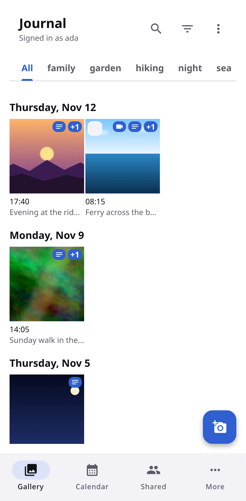
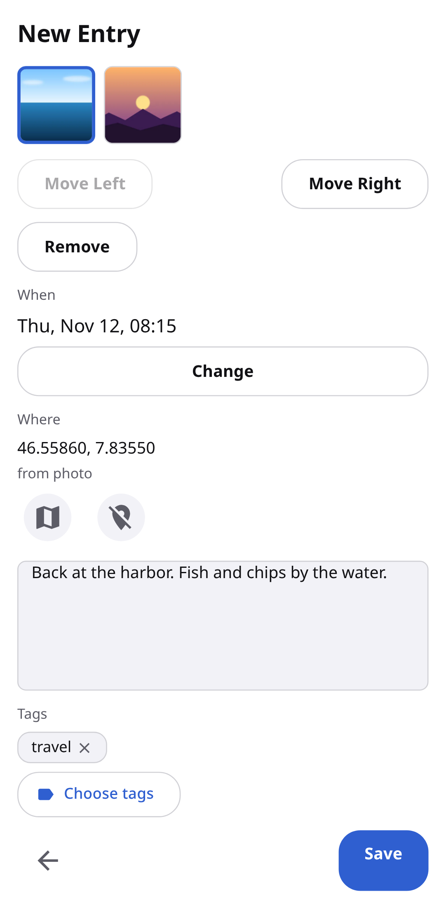

# Kodakiko

An end-to-end encrypted photo and video journal. An entry is a moment: several photos or videos,
voice notes and a markdown note, with a time, a place and tags. Everything is encrypted on the
device; the server and the S3 bucket only store ciphertext. One Expo codebase builds the Android
app and a web app that works on phones.

<p>
  
  
  
</p>

More screenshots: [docs/screenshots](docs/screenshots/README.md). What every screen does:
[docs/guide.md](docs/guide.md).

## Get it

**Android:** download the APK from the [releases](https://github.com/0x42697262/kodakiko/releases)
(signed, `arm64-v8a`, with a `.sha256`). Without a server it runs in local-only mode; connect a
server later from Settings.

**Server and web app:** a Docker Compose stack (Caddy, API, Postgres, Garage) for your own machine,
reached over a VPN or the internet. Setup, backups and restore: [docs/operations.md](docs/operations.md).

## Run it locally

Needs Node ≥ 22.18, pnpm (`corepack enable` picks the pinned version) and Docker.

```sh
pnpm install
docker compose -p kodakiko-dev -f infra/compose/docker-compose.dev.yml up -d --wait
sh infra/compose/dev/bootstrap-garage.sh
pnpm --filter @kodakiko/server build
node --env-file=apps/server/.env.dev apps/server/dist/cli.js apply-bucket-cors
node --env-file=apps/server/.env.dev apps/server/dist/cli.js create-invite --role admin --expires-days 7
pnpm --filter @kodakiko/server dev            # terminal 1
pnpm --filter @kodakiko/client start:web      # terminal 2
```

Open `https://localhost:9443`, then the invite link that `create-invite` printed, and create the
first account. Android builds and device setup: [docs/development.md](docs/development.md).

## What it does

| Area | What you get |
|---|---|
| Capture | Full-screen camera (photo, video, hold to record), import from the gallery or files, paste and drag-and-drop on the web; time and place read from EXIF |
| Edit page | Autosaves every change. Media pager with page dots, captions, set as cover, crop, inline video autoplay, voice notes, markdown note with a formatting toolbar, tags from your tag list, paste |
| Browse | Gallery grouped by day, month, year or tag, tag tabs, favorites, filters, search (notes and captions), calendar, On This Day |
| Share | Read-only journals for other accounts on the server (with security codes), public links with metadata stripped, or plain files to other apps |
| Offline | Local encrypted database and outbox; works offline and syncs later; originals cached and pinned for offline use |
| Safety | App lock with biometrics, secure screen, recovery key (24 words), encrypted `.kdkx` backups that a script can open without the app |
| Admin | Invites, quotas and roles in the app and from the server CLI |

The look follows Mihon (Material 3): icon navigation, a Filter/Sort/Display/Group sheet, a More tab
and searchable settings for almost every behavior.

## How it is built

| Part | Path | Job |
|---|---|---|
| Client | `apps/client` | Expo / React Native app for Android and web (expo-router, react-native-paper) |
| Server | `apps/server` | Fastify API on Postgres (Kysely); hands out presigned bucket URLs, never sees plaintext |
| Core | `packages/core` | Crypto, byte formats, entry rules, the local index, sync merge, export format; no platform code |
| Contract | `packages/contract` | Zod schemas and routes shared by client and server |
| Native upload | `packages/native-upload` | Android background upload module |
| Infrastructure | `infra/` | Dockerfiles, Compose stacks, Caddy, Garage, backup scripts and systemd units |
| Tests | `tests/e2e`, `tests/ui` | Two-device scenarios against a real server; Playwright and Maestro UI flows |

More: [docs/architecture.md](docs/architecture.md) and [docs/encryption.md](docs/encryption.md).

## Commands

| Command | What it does |
|---|---|
| `pnpm verify` | Lint, typecheck and every unit test |
| `pnpm ui:web` | Playwright UI flows on desktop and phone viewports (starts its own stack) |
| `pnpm ui:android U-NN` | Maestro UI flows on the Android emulator |
| `pnpm test:e2e` | Client scenarios against a real server (needs the test stack) |
| `pnpm --filter @kodakiko/server test:integration` | Server tests on Postgres and Garage (needs the test stack) |
| `pnpm --filter @kodakiko/ui-tests screenshots` | Regenerates `docs/screenshots/` |
| `pnpm --filter @kodakiko/core decrypt-export <parts…>` | Turns encrypted `.kdkx` export parts back into zip files |
| `node apps/server/dist/cli.js help` | Server CLI: invites, users, quotas, roles, stats, migrations, bucket CORS |

Test stack: `docker compose -f infra/compose/docker-compose.test.yml up -d --wait`. Details:
[docs/testing.md](docs/testing.md).

## Documentation

[docs/README.md](docs/README.md) lists every document: the user guide, operations, development and
the design reference, then the build history (feature specs, decisions, reviews).

## License

[GNU General Public License v3.0](LICENSE).
