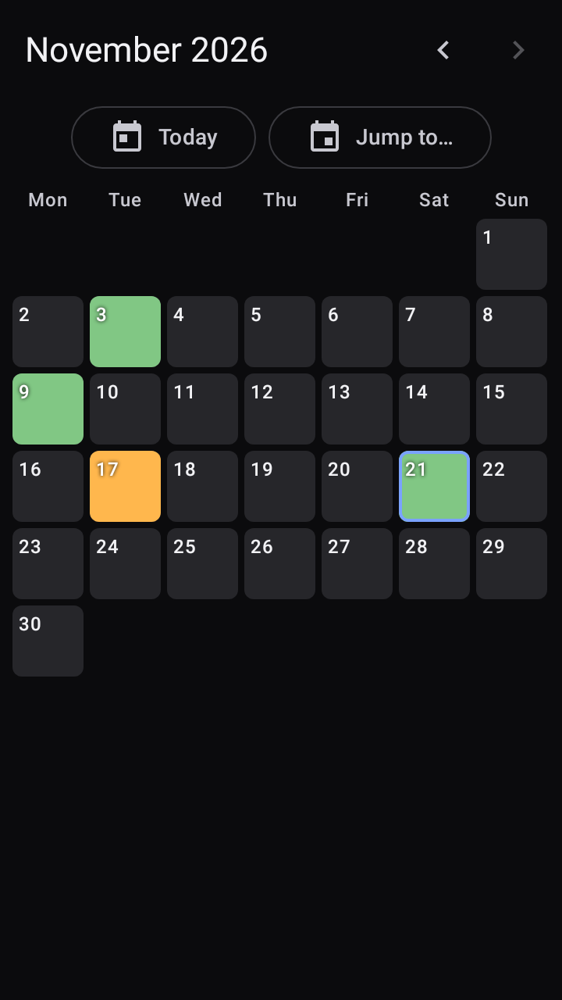
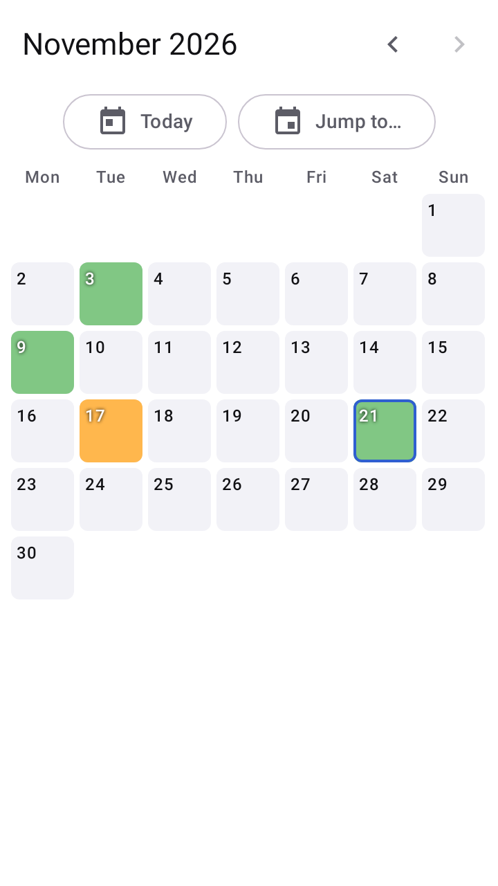
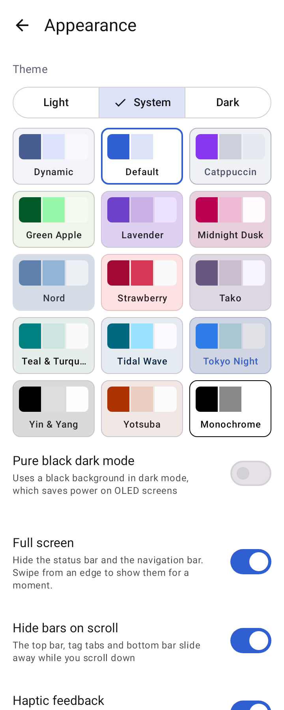

# Kodakiko

An end-to-end encrypted photo and video journal. An entry is a moment: several photos or videos,
voice notes and a markdown note, with a time, a place and tags. Everything is encrypted on the
phone; the server and the S3 bucket only store ciphertext.

Since v0.4.0 the app is a native Android app written in Kotlin with Jetpack Compose; its look
follows Mihon (Material 3). There is no web app. Public links open in a browser through a small
standalone link viewer served by the server's Caddy.

<p>
  
  
  
  
</p>

## Screenshots

| Gallery | Calendar | Viewer | Edit page |
|---|---|---|---|
|  |  |  |  |

| Settings | Appearance | More | Lock screen |
|---|---|---|---|
|  |  |  |  |

All screenshots, light and dark: [docs/screenshots](docs/screenshots/README.md). What every screen
does: [docs/guide.md](docs/guide.md).

## Get it

**Android (8.0 or newer):** download `kodakiko-vX.Y.Z.apk` from the
[releases](https://github.com/0x42697262/kodakiko/releases) (signed, with a `.sha256`). Without a
server it runs in local-only mode; connect a server later from Settings.

**Upgrading from v0.3.1:** the APK installs as an update over v0.3.1 (same app id, same signing
key) and takes over the journal on the phone: entries, media, voice notes, tags, trash, pending
changes and the unlock setup. Before installing, make an encrypted backup in v0.3.1 (Settings ›
Data and storage › Create backup) and copy it off the phone.

**Server:** a Docker Compose stack (Caddy, API, Postgres, Garage) for your own machine, reached
over a VPN or the internet. Caddy serves the API and the public link viewer (`/s/…`); every other
page is a "Get the Android app" page. Setup, backups and restore:
[docs/operations.md](docs/operations.md).

## Build it

Needs JDK 21 (Gradle and the tests run on it; the code targets Java 17), the Android SDK
(`nix develop` provides it), Node ≥ 22.18 with pnpm (`corepack enable`), and Docker for the server.

```sh
pnpm install
cd apps/android
./gradlew :app:assembleDebug      # debug build, app id com.x42697262.kodakiko.next
./gradlew :app:assemblePreview    # release-like build, debug-signed, installs next to the real app
./gradlew verify                  # formatting, tooling rules, unit, Robolectric and screenshot tests, lint
```

Debug and preview builds use the app id `com.x42697262.kodakiko.next`, so they install next to the
released app. Release builds are made and signed by CI from a `v*` tag
([docs/development.md](docs/development.md#releases)).

## Run the server locally

```sh
docker compose -p kodakiko-dev -f infra/compose/docker-compose.dev.yml up -d --wait
sh infra/compose/dev/bootstrap-garage.sh
pnpm --filter @kodakiko/server build
node --env-file=apps/server/.env.dev apps/server/dist/cli.js apply-bucket-cors
node --env-file=apps/server/.env.dev apps/server/dist/cli.js create-invite --role admin --expires-days 7
pnpm --filter @kodakiko/server dev
```

Then connect the app to it from the welcome screen with the invite link that `create-invite`
printed. Emulator and phone setup against the dev stack: [docs/development.md](docs/development.md).

## What it does

| Area | What you get |
|---|---|
| Capture | Full-screen camera (photo, video, hold to record), import from the photo picker; time and place read from EXIF; optionally delete the imported originals from the phone after saving |
| Edit page | Media pager with page dots, captions on the photo, set as cover, crop, voice notes, date and time pickers, tags as chips, a full-screen markdown note editor with Code / Preview and Copy. Changes are saved with Done; Back on a changed entry asks Save / Discard / Keep editing |
| Browse | Gallery grouped by day, month, year or tag, tag tabs, favorites, filters, search (notes and captions), calendar with a month picker, On This Day; tap a photo for full screen |
| Share | Read-only journals for other accounts on the server (with security codes), public links with metadata stripped, or plain files to other apps |
| Offline | Local encrypted database and outbox; works offline and syncs later; originals cached and pinned for offline use |
| Safety | App lock with biometrics or the device PIN, secure screen, recovery key (24 words), encrypted `.kdkx` backups that a script can open without the app |
| Look | Light, dark and pure black themes, fourteen color presets or dynamic color, icons on every settings row |
| Admin | Invites, quotas and roles in the app and from the server CLI |

## How it is built

| Part | Path | Job |
|---|---|---|
| Android app | `apps/android` | Kotlin, Jetpack Compose and Material 3; Gradle modules in layers (`:shared:*`, `:data:*`, `:platform:*`, `:service:*`, `:ui:*`, `:app`) |
| Server | `apps/server` | Fastify API on Postgres (Kysely); hands out presigned bucket URLs, never sees plaintext |
| Link viewer | `apps/link-viewer` | Standalone web page (TypeScript, no framework) that opens public links in a browser |
| Core | `packages/core` | TypeScript crypto, byte formats and export format for the server, the link viewer and `decrypt-export`; the reference the Kotlin port is tested against |
| Contract | `packages/contract` | Zod schemas and routes shared by the server and the link viewer |
| Infrastructure | `infra/` | Dockerfiles, Compose stacks, Caddy, Garage, backup scripts and systemd units |
| Tests | `apps/android/e2e`, `tests/ui` | Two simulated devices on the Kotlin services against a real server; Maestro Android flows and the link-viewer browser test |

More: [docs/architecture.md](docs/architecture.md) and [docs/encryption.md](docs/encryption.md).

## Commands

| Command | What it does |
|---|---|
| `pnpm verify` | Lint, typecheck and unit tests of the TypeScript parts, plus the generated Android strings and license list |
| `./gradlew verify` (in `apps/android`) | Every check of the Android app: formatting, tooling rules, unit, Robolectric and Roborazzi screenshot tests, lint |
| `./gradlew e2e` (in `apps/android`) | Kotlin services against the real server (needs the test stack and Node) |
| `pnpm ui:android U-NN` | Maestro UI flows on the Android emulator |
| `pnpm ui:link-viewer` | Browser test of the public link viewer (starts its own stack) |
| `pnpm --filter @kodakiko/server test:integration` | Server tests on Postgres and Garage (needs the test stack) |
| `pnpm --filter @kodakiko/core decrypt-export <parts…>` | Turns encrypted `.kdkx` export parts back into zip files |
| `node apps/server/dist/cli.js help` | Server CLI: invites, users, quotas, roles, stats, migrations, bucket CORS |

Test stack: `docker compose -f infra/compose/docker-compose.test.yml up -d --wait`. Details:
[docs/testing.md](docs/testing.md).

## Documentation

[docs/README.md](docs/README.md) lists every document: the user guide, operations, development, the
feature docs and the design reference.

## License

[GNU General Public License v3.0](LICENSE). Parts of the Android UI are adapted from
[Mihon](https://github.com/mihonapp/mihon) (Apache-2.0); see Settings › About in the app and
[docs/dependencies.md](docs/dependencies.md).
