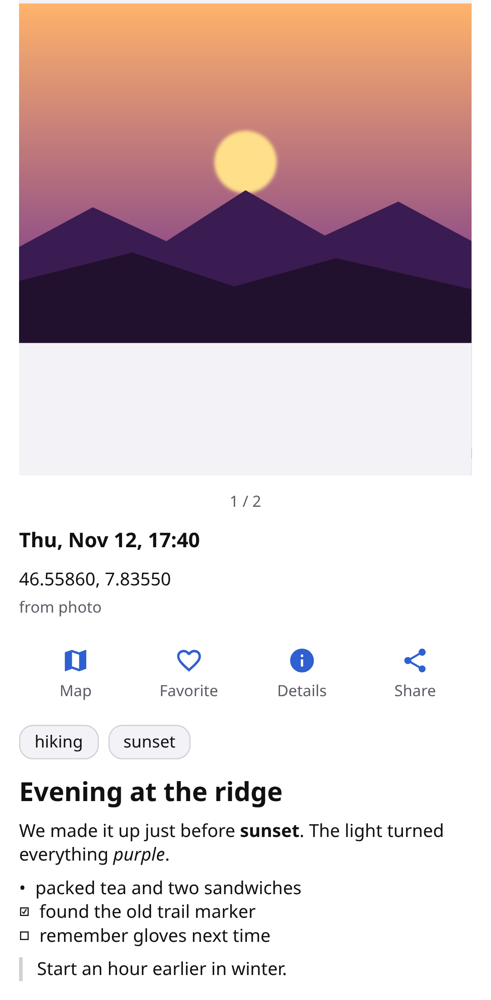
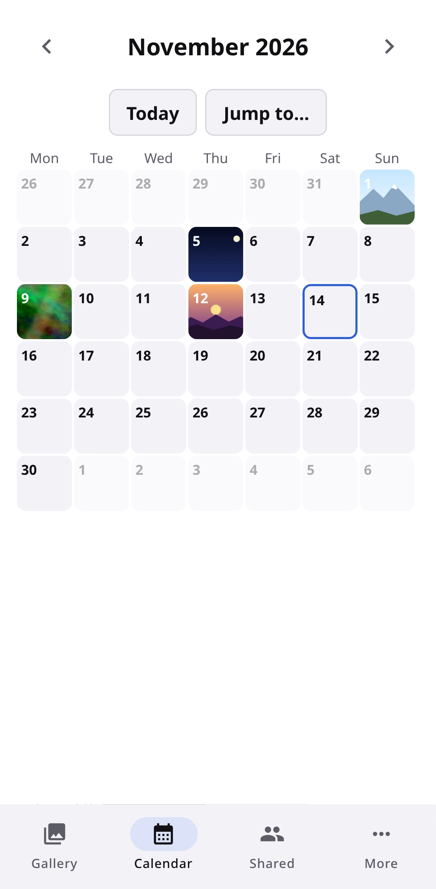

# Kodakiko

Kodakiko is an end-to-end encrypted photo and video journal. Each entry holds several photos or
videos plus a markdown note. You organize with tags instead of folders, and browse like a gallery
or a calendar. Everything is encrypted on the device before it leaves it; the server and the
S3-compatible bucket only ever store ciphertext. It supports multiple users, and ships as an
Android app and a mobile-friendly web app built from one Expo codebase.

<p>
  
  
  
</p>

More screenshots: [docs/screenshots](docs/screenshots/README.md).

## What works today

| Area | Status |
|---|---|
| Accounts: invite or open sign-up, recovery key (24 words), password change via recovery, deletion with grace period | Done |
| End-to-end encryption: Argon2id + XChaCha20-Poly1305, chunked STREAM format for media, sealed key sharing | Done |
| Capture and import: camera/picker on Android, file picker, paste and drag-and-drop on web; EXIF time and location | Done |
| Entries: note (markdown), tags, time and location editing, trash and restore, multi-select actions | Done |
| Offline-first sync: local encrypted database, outbox, conflict merge, background uploads | Done |
| Gallery (grouped by day, tag and text filters, On This Day) and calendar | Done |
| Entry viewer: swipe, pinch and double-tap zoom, markdown note, edit screen | Done |
| Thumbnail and original caches, pinning for offline, eviction, "large uploads on Wi-Fi only" | Done |
| Video playback: web streams through a service worker that decrypts byte ranges; Android plays a temp file | Done |
| App lock: auto-lock (background on Android, idle on web), lock now, biometric unlock, "keep me unlocked" on web | Done |
| Read-only sharing of journals with other users on the same server, with security codes | Done |
| Public links with metadata stripped from photos and videos; admin screen and CLI | Done |
| Settings, password change, account deletion, journal export to zip files | Done |
| Local-only mode on Android: use the app without a server, connect one later | Done |
| Material 3 interface modeled on Mihon: icon navigation, tag tabs, Filter/Sort/Display/Group sheet, favorites, More tab, searchable settings with many options | Done |
| Power-user detail: statistics cards, entry details, server and keys, advanced settings | Done |
| Backup and restore: export to zip or passphrase-encrypted `.kdkx`, import into any account, `decrypt-export` script | Done |
| Production deployment: Docker images, Caddy with DNS-01 TLS, compose stack, backups ([operations guide](docs/operations.md)) | Done (phase 1, local builds); CI and release workflow in phase 2 |

Verified on desktop browsers and the Android emulator. Still to check on a real phone: background
uploads, biometric unlock, and key-derivation timing.

The build plan lives in [docs/features/README.md](docs/features/README.md); every spec has an
implementation-notes section that records what changed during the build.

## How it is built

- **One TypeScript monorepo** (pnpm workspaces):
  - `apps/client`: Expo / React Native app for Android and web, with expo-router.
  - `apps/server`: Fastify API on Postgres (Kysely), which hands out presigned URLs for the bucket.
  - `packages/core`: crypto, the local index and domain logic, shared by client and tests.
  - `packages/contract`: Zod schemas and routes shared by client and server.
  - `packages/native-upload`: Android background upload module.
- **Storage:** Garage (S3-compatible) holds immutable encrypted objects; the server never sees
  plaintext, keys or file names.
- **Deployment target:** a Docker Compose stack (Caddy, API, Postgres, Garage) reached over a VPN
  first, ready to go public later. Setup, backups and restore: [docs/operations.md](docs/operations.md).

Start with [docs/architecture.md](docs/architecture.md) for the system map; the full document index
is in [docs/README.md](docs/README.md).

## Requirements

- Node ≥ 22.18 and pnpm 12.17.0 (`corepack enable` picks the pinned version).
- Docker with the Compose plugin (dev, test and UI stacks).
- For Android builds: Nix with flakes (`nix develop` provides the SDK, NDK and JDK).

## Quick start (local web app)

```sh
pnpm install
docker compose -p kodakiko-dev -f infra/compose/docker-compose.dev.yml up -d --wait
sh infra/compose/dev/bootstrap-garage.sh
pnpm --filter @kodakiko/server build
node --env-file=apps/server/.env.dev apps/server/dist/cli.js apply-bucket-cors
node --env-file=apps/server/.env.dev apps/server/dist/cli.js create-invite --role admin --expires-days 7
pnpm --filter @kodakiko/server dev            # terminal 1
pnpm --filter @kodakiko/client start:web      # terminal 2
```

Open `https://localhost:9443`, then open the invite link printed by `create-invite` to create the
first account. Caddy serves local HTTPS with its own CA. Android device setup is in
[docs/development.md](docs/development.md).

## Testing

| Command | What it runs |
|---|---|
| `pnpm verify` | Lint, typecheck and all unit tests |
| `pnpm --filter @kodakiko/server test:integration` | Server integration tests on Postgres and Garage (needs the test stack below) |
| `pnpm test:e2e` | Two-device client scenarios against a real server (needs the test stack below) |
| `pnpm ui:web` | Playwright UI flows, desktop and mobile viewports (starts its own stack) |
| `pnpm ui:android U-NN` | Maestro UI flows on the Android emulator |

Test stack: `docker compose -f infra/compose/docker-compose.test.yml up -d --wait`.
