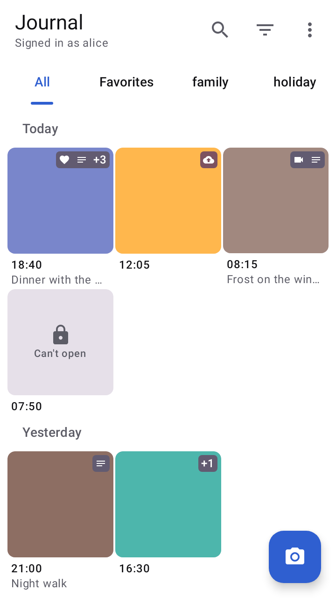
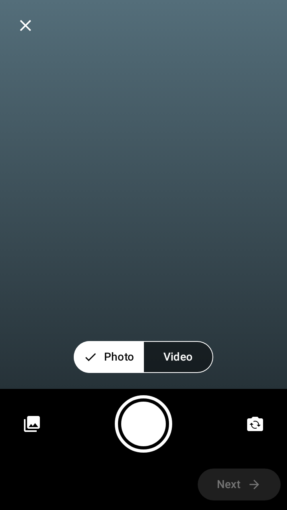
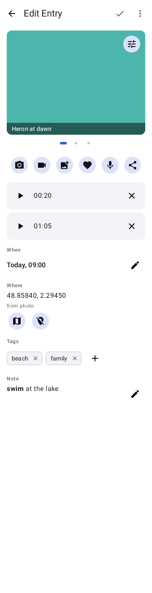
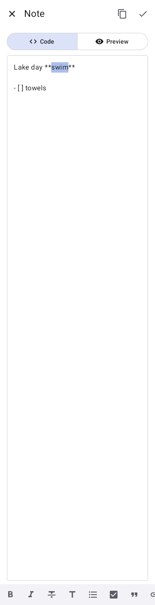
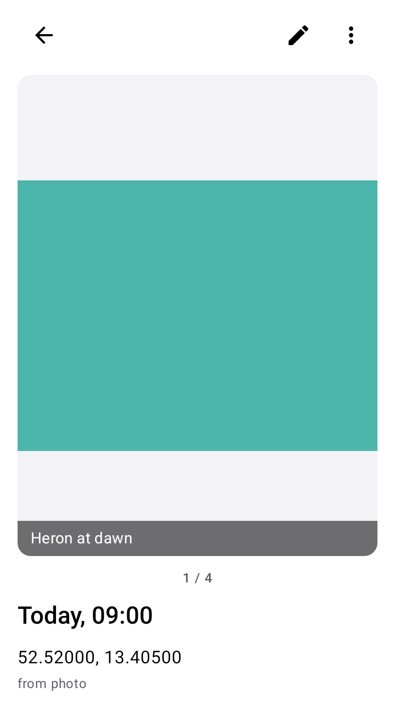
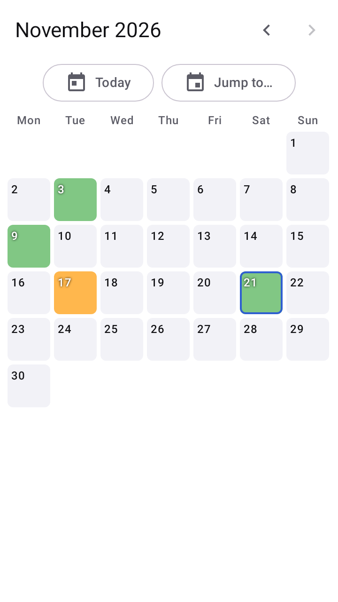
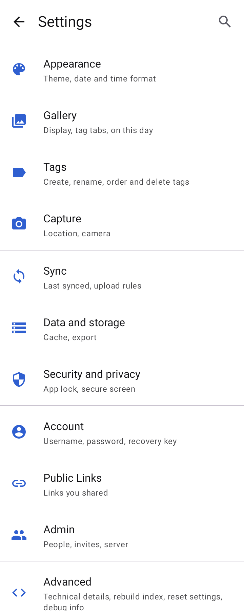
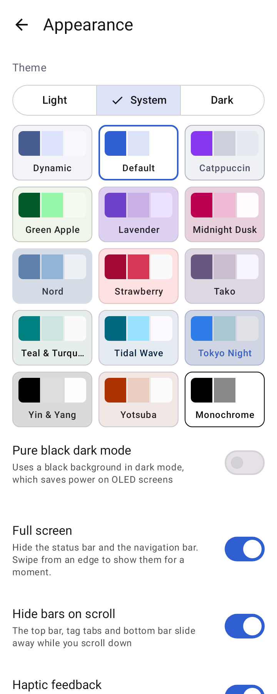
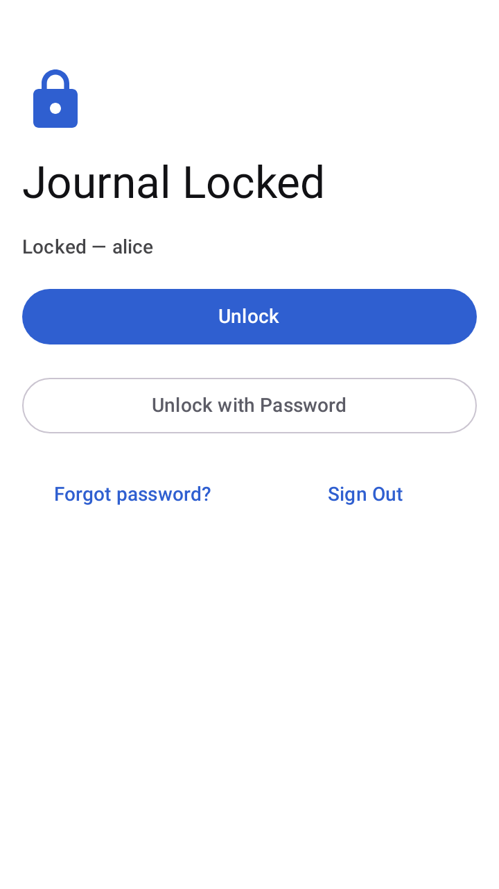

# User guide

What each screen of the Android app does. Settings that change a behavior are named in **bold**;
all of them can be found with the search field at the top of Settings. The details of every
screen are in [features/](features/README.md).

## First start

| Choice | What happens |
|---|---|
| Create an account | Needs an invite link from an admin (or open sign-up, if the server allows it). You choose a password; the app shows a **recovery key** of 24 words and asks you to confirm some of them. The recovery key is the only way back if you forget the password |
| Sign in | Server address, username and password. The key derivation takes a few seconds on purpose |
| Use without a server | Local-only mode: everything stays on the phone, nothing is uploaded. Settings › Account › **Connect a Server…** moves the journal to a server later; **Erase This Journal…** deletes it. Local-only journals are the only copy, so make backups (see below) |

Updating from v0.3.1 keeps your journal: install the new app over the old one and unlock as
usual. Make a backup first anyway (see below).

## Gallery



The home tab. Entries are tiles grouped by day (or month, year, tag, or no grouping). Each tile
shows the cover photo, the time, the start of the note and small badges (note, video, number of
items, favorite, waiting to upload).

- **Tag tabs** across the top: All, Favorites, then your tags in the order of Settings › Tags.
- **Search** (magnifier) finds words in notes and captions.
- **Filter** opens a sheet with four tabs: Filter (has video, has note, several items, shared,
  waiting to upload, favorite, tags, dates), Sort, Display (comfortable grid, compact grid,
  photo-only grid, list; items per row; badges) and Group. Drag the sheet down to close it.
- Long-press a tile to select; then trash, add or remove a tag, favorite or share several entries.
- Pull down to sync now.
- **On This Day** shows entries from the same date in earlier years.
- The round button opens the camera.

<br clear="right">

## Capture



A full-screen camera with a Photo / Video switch. Tap the shutter for a photo (or to start and
stop a video in video mode). Hold the shutter to record a short clip in either mode
(**Hold to record**, up to **Maximum hold-to-record length**). The gallery button opens the
Android photo picker. **Camera app** can hand capture to the phone's own camera instead.

Taken items collect in a tray at the bottom. **Next** creates the entry and opens the edit page.
Time and place come from the photos' EXIF data (or the device location, if **Add location to new
photos** is on).

<br clear="right">

## Edit page



Since v0.4.1 changes are kept until you save them (v0.3.1 and v0.4.0 saved as you typed):

- **✓ (Done)** saves and goes back.
- **Back** on a changed entry asks: **Save**, **Discard** or **Keep editing**. A new entry always
  asks. **Discard** puts an existing entry back the way it was (photos and voice notes added since
  you opened it are removed); on a new entry it deletes the entry.
- Locking the phone or the app still saves what you typed.

What is on the page:

- **Media pager:** swipe through the photos and videos; the dots below jump to a page. A caption
  sits on its photo. The **tune** button on a page (or a tap on a photo) opens Caption (one line,
  up to 64 characters), Set as Cover, Share, Save to Device, Crop (photos; the cropped copy
  replaces the original) and Remove.
- **Action bar:** take a photo, record a video, add from the phone (opens the photo picker),
  favorite, voice note, paste a picture (when the clipboard holds one) and share.
- **Voice notes:** the microphone records; the list shows each note with play and its length.
- **When:** tap the pencil, then the date or time field to pick from a calendar or a clock.
- **Where:** open the place on a map or remove it.
- **Tags:** your tags as chips; **+** opens your tag list as chips to tap on or off (tags are
  created in Settings › Tags).
- **Note:** markdown. Tap the pencil to open the full-screen note editor:



  - **Code** shows the text with a toolbar above the keyboard (bold, italic, strikethrough,
    heading, list, checklist, quote, link, current time); **Preview** shows it formatted.
  - **Copy** copies the markdown in Code and the plain text in Preview.
  - Done or Close returns to the edit page; the note is saved with the entry.
- The ⋮ menu at the top has View Entry and Move to Trash.

**Deleting the originals from the phone** (new in v0.4.1): after you save an entry with photos or
videos picked from the phone's gallery, the app asks whether to delete those originals from the
phone. **Keep** is the default; **Delete** shows Android's own confirmation (Android 11 and newer).
The photos stay in your Kodakiko journal either way.

<br clear="right">

## Viewer



Opened from any tile. Swipe between items, pinch or double-tap to zoom, listen to voice notes.
Captions are drawn on their photo. Tap a photo to see it full screen on black; tap again to leave.
Videos play muted and loop when **Autoplay videos** is on (tap the speaker for sound, tap the
video for the full player). The action row has favorite, details (sizes, dates, sync state), map
and share. Edit opens the edit page; the ⋮ menu has keep offline, add photos or videos, move to
trash and share.

<br clear="right">

## Calendar



A month grid with the cover photo on each day that has entries; days of the next and previous
month are left blank. Swipe or use ‹ › to change months; past the current month it only goes to
months that have entries. Tap a day to see its entries. **Today** goes back to this month;
**Jump to…** opens a year and month picker.

<br clear="right">

## Sharing

The Share sheet opens over the screen you are on and has two parts:

| Part | What it does |
|---|---|
| In Kodakiko | Adds entries to a shared journal that other accounts on the server can read (read-only), or creates a public link. Compare the security code with the other person before sharing. Public links copy the chosen photos and videos with their metadata removed, and can expire or allow one view. Anyone with a link opens it in a web browser; no app or account is needed |
| To apps | Decrypts the chosen items and hands them to another app (messages, files). Those copies are no longer encrypted. **Include text** adds captions or the note. Photos that are only on the server are downloaded first |

When only To apps is possible (a journal without a server, or a server with sharing and links
off), sharing one entry opens Android's share menu directly.

The Shared tab lists journals shared with you; Settings › Public Links lists your public links.

## More

Switches for **Hide shared journals** and **Pause sync**, and rows for Lock Now, Tags (create,
rename, reorder, delete), Statistics, Trash, Data and storage, Settings, About and Help.

## Settings




Each row has an icon, and related rows are grouped (since v0.4.1).

| Screen | What is there |
|---|---|
| Appearance | Theme: Light / System / Dark, then 14 color themes as tiles (Dynamic first on Android 12+, which takes the colors from your wallpaper), pure black dark mode; full screen, hide bars on scroll, haptic feedback, date and time format, relative dates, start screen |
| Gallery | Display mode, items per row, grouping, badges, tag tabs and counts, On This Day, confirm before trash, hide shared |
| Tags | The tag list: add, rename (renames it on every entry), reorder, delete |
| Capture | Add location to new photos, start with the back or front camera, keep the screen on, camera app, hold to record and its length |
| Sync | Sync now, retry failed uploads |
| Data and storage | Create backup and restore backup, original cache size, clear cached originals, large uploads on Wi-Fi only, autoplay videos, autoplay on mobile data |
| Security and privacy | Auto-lock time, biometric unlock, encrypt thumbnails, secure screen, hide note previews |
| Account | Username, server, storage used, security code, Server and keys, change password, show recovery key, delete account |
| Public Links, Admin | Your public links; for admins: invites, users, quotas, roles |
| Advanced | Technical details, rebuild the local index, reset settings, the debug log, debug info |
| About | Versions and open-source licenses |

**Debug log** (Advanced, new in v0.4.1): a file on the phone that records what the app did (ids,
counts, timings and errors, never your notes, captions, tags, file names or passwords) to help find
problems. **View debug log** shows it with Copy, Share and Clear. It is on by default only in test
builds; crashes are always recorded. Details: [features/settings.md](features/settings.md#debug-log).

<br clear="right">

## Backup and restore

Data and storage › **Create backup** writes the whole journal as zip files into a folder you
choose: one folder per entry with the original files and an `entry.md` (front matter with time,
tags, place, favorite and captions, then the note). Turn on **Encrypt with a passphrase** to write
`.kdkx` files instead; they open only with that passphrase. Without the app:

```sh
KODAKIKO_EXPORT_PASSPHRASE='…' pnpm --filter @kodakiko/core decrypt-export part01.zip.kdkx
```

**Restore backup** reads plain or encrypted backups into any account, including large ones.
Entries that already exist (same time and number of items) are skipped.

## Lock and trash



The app locks after the **auto-lock** time in the background; unlock with the password,
fingerprint, face or the phone's screen lock. Lock Now is in the More tab, the gallery's ⋮ menu
and at the bottom of Settings. Trashed entries stay in Trash until you delete them for good, or
until the server's trash period ends; moving an entry to trash shows an Undo.

<br clear="right">
