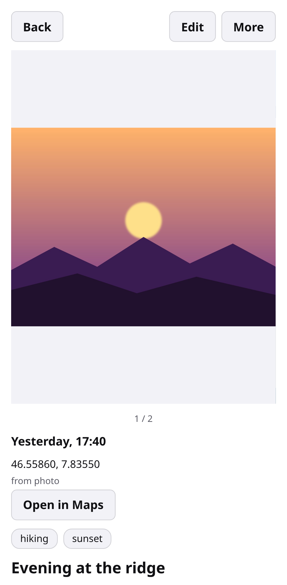
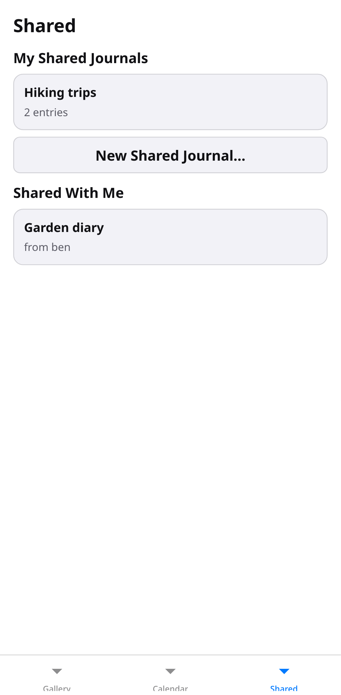
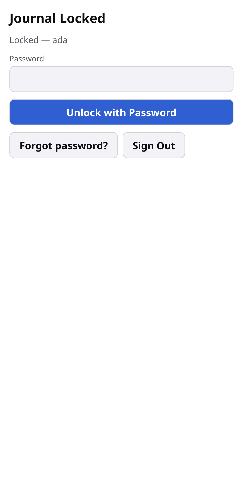
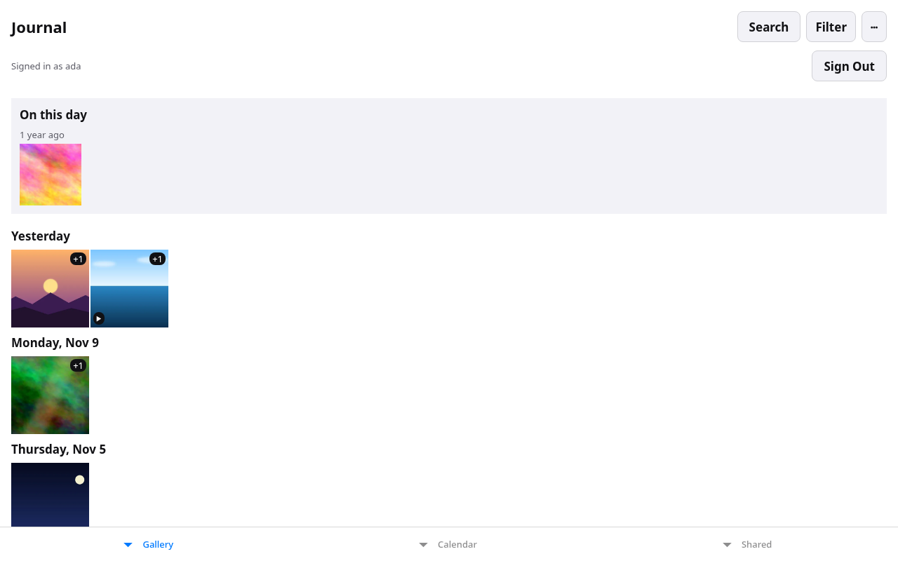
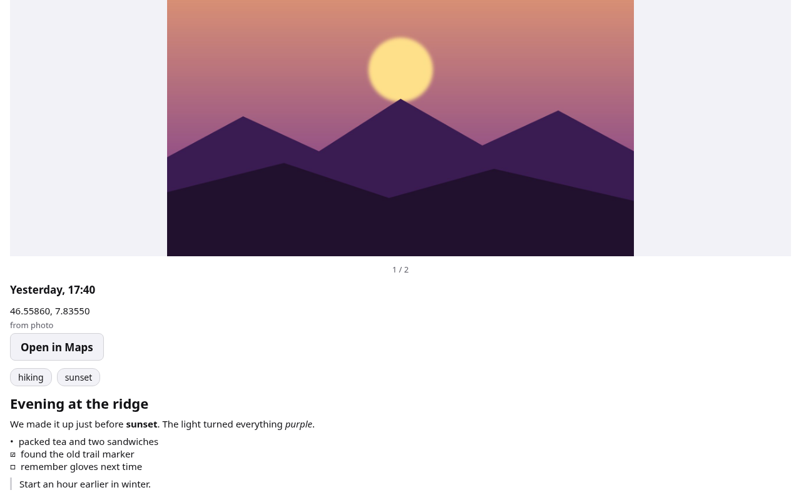
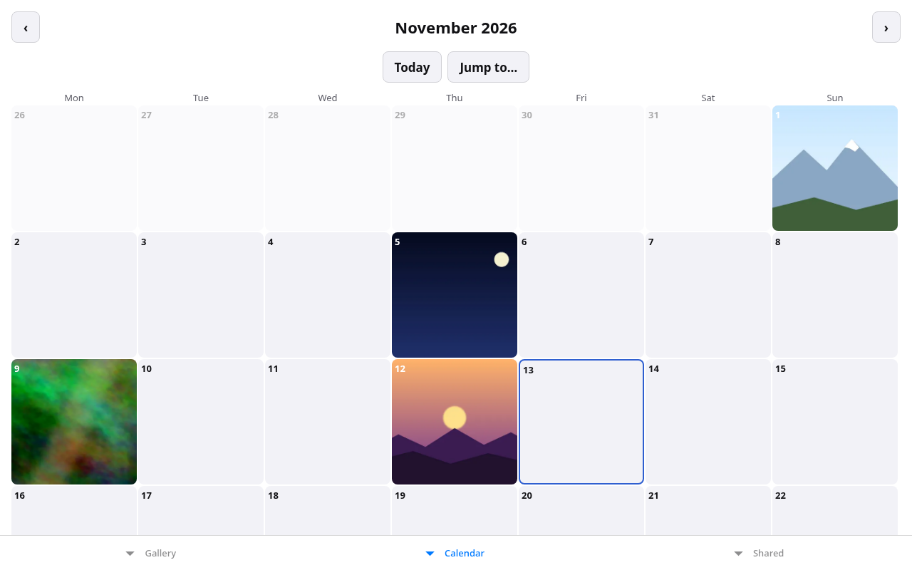
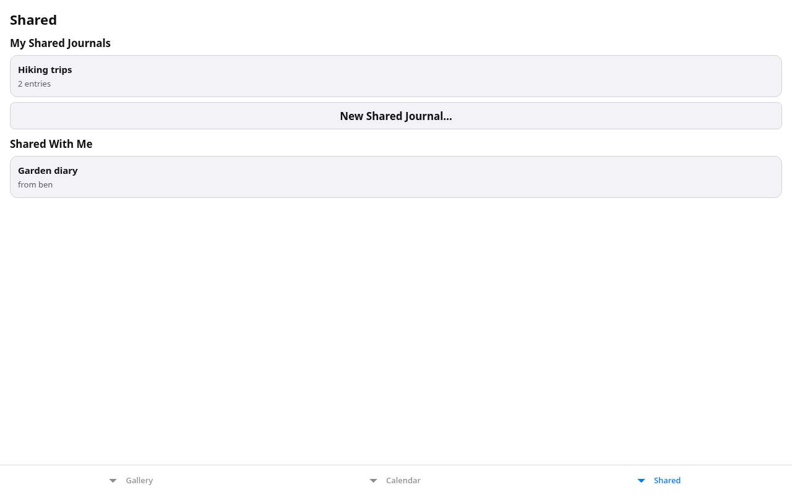

# Screenshots

Captured from the web app with demo data by `pnpm --filter @kodakiko/ui-tests screenshots`
(`tests/ui/screenshots/`). The script starts the UI test stack and generates demo photos and a
video with ImageMagick and ffmpeg. It creates the entries through the web UI, so the thumbnails are
real, and saves the PNGs here. Re-run it after UI changes.

## Phone-sized browser (Pixel 7 viewport)

| Gallery | Viewer | Viewer, note |
|---|---|---|
|  |  |  |

| Calendar | Shared journals | New entry |
|---|---|---|
|  |  |  |

| Lock screen |
|---|
|  |

## Desktop browser (1280 × 800)

Android screenshots will be added with the Android verification round.
