# Screenshots

Screenshots of the Android app (v0.4.1). They are copies of Roborazzi baselines: the screenshot
tests render each screen on Robolectric at 360 × 640 dp with fixed demo data (colored squares
stand in for photos), and the baselines live next to each UI module in
`apps/android/**/src/test/screenshots/<area>/<name>.png` ([../testing.md](../testing.md#screenshots-roborazzi)).

To refresh this folder after an intended UI change, re-record the baselines, look at them, then copy
the files listed below over the ones here.

| File | Baseline |
|---|---|
| `gallery.png`, `gallery-dark.png` | `ui/feature/gallery/…/gallery/comfortable_grid.png`, `comfortable_grid_dark.png` |
| `calendar.png`, `calendar-dark.png` | `ui/feature/calendar/…/calendar/month_covers.png`, `month_covers_dark.png` |
| `viewer.png`, `viewer-dark.png` | `ui/feature/viewer/…/viewer/full_entry.png`, `full_entry_dark.png` |
| `edit.png`, `note-editor.png` | `ui/feature/edit/…/edit/full_entry.png`, `note_editor.png` |
| `settings.png`, `settings-dark.png` | `ui/feature/settings/…/settings_root/server_admin.png`, `server_dark.png` |
| `appearance.png` | `ui/feature/settings/…/appearance/default.png` |
| `more.png`, `statistics.png` | `ui/feature/more/…/more/server.png`, `statistics/full.png` |
| `lock.png` | `ui/feature/lock/…/lock/locked.png` |
| `capture.png` | `ui/feature/capture/…/capture/camera.png` |

## Gallery, calendar, viewer

| Gallery | Calendar | Viewer |
|---|---|---|
| 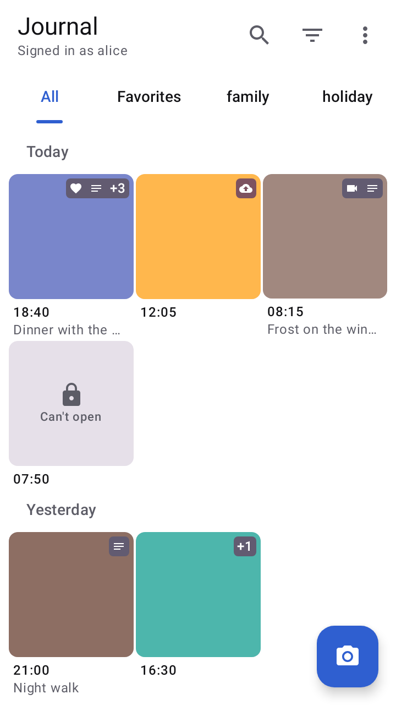 | 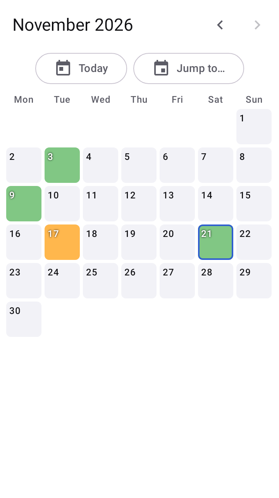 | 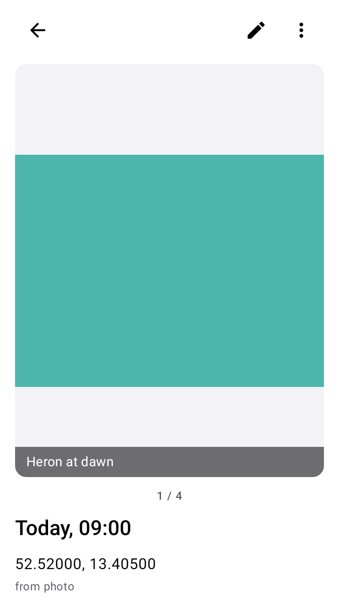 |
| 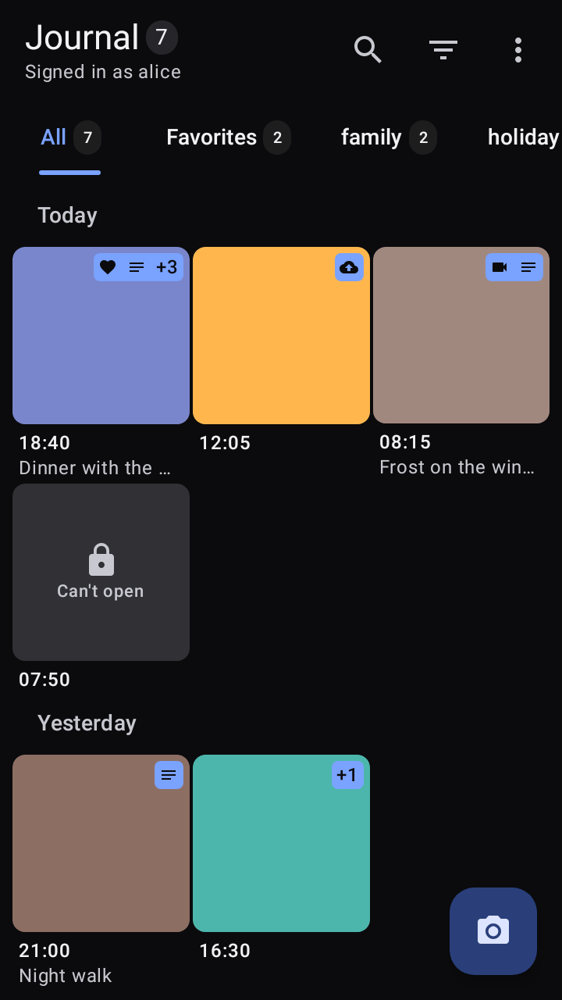 | 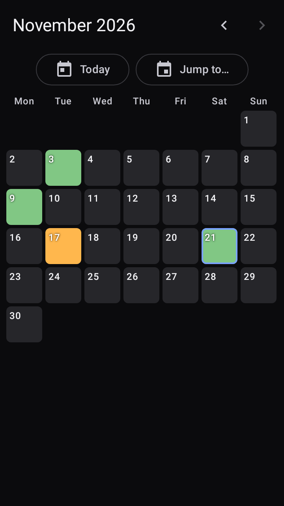 | 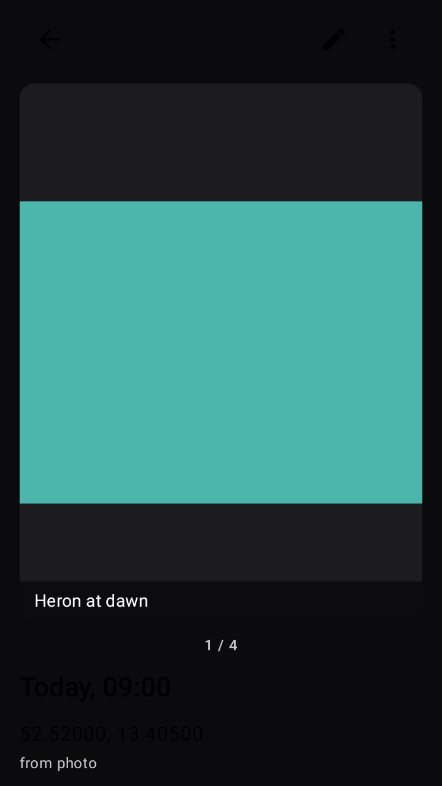 |

## Capture and editing

| Camera | Edit page | Note editor |
|---|---|---|
| 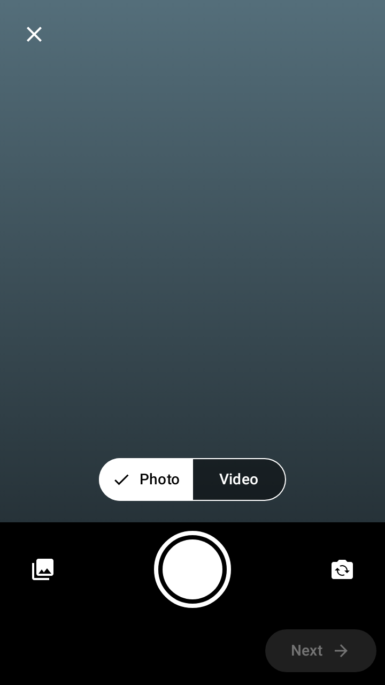 | 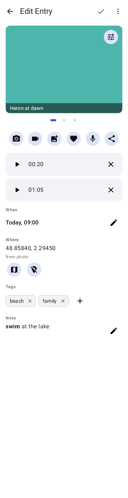 | 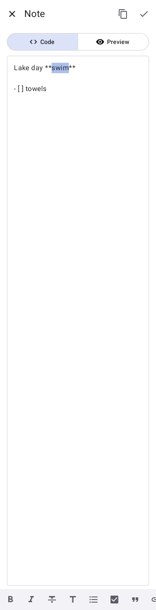 |

## Settings and More

| Settings | Settings, dark | Appearance |
|---|---|---|
| 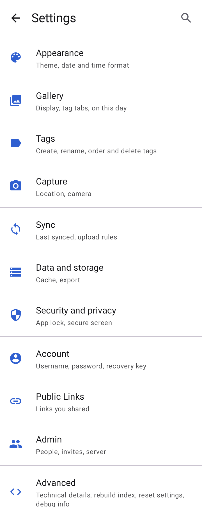 | 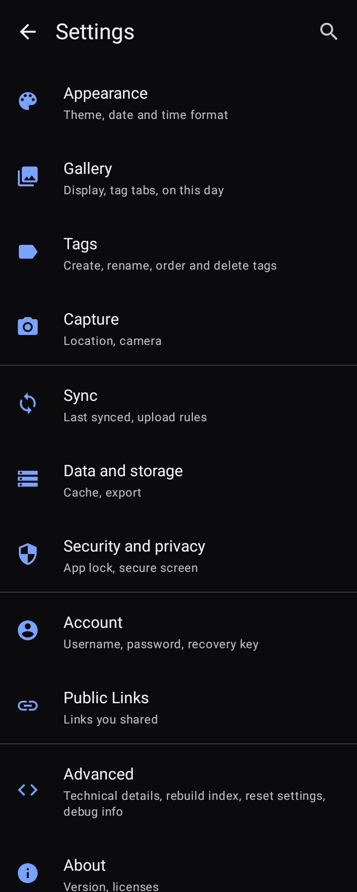 | 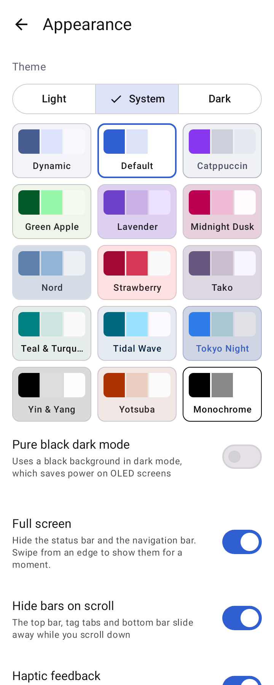 |

| More | Statistics | Lock screen |
|---|---|---|
| 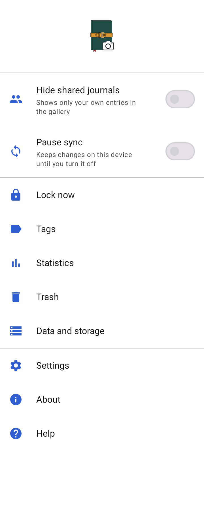 | 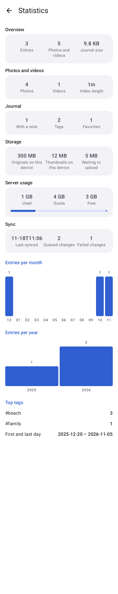 | 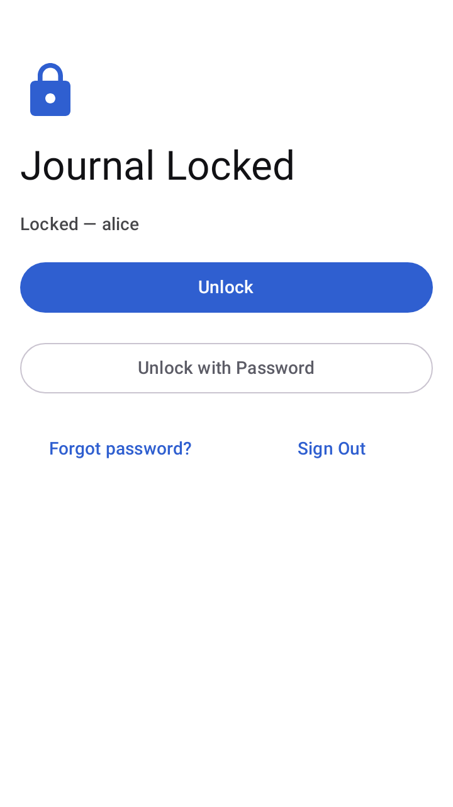 |
